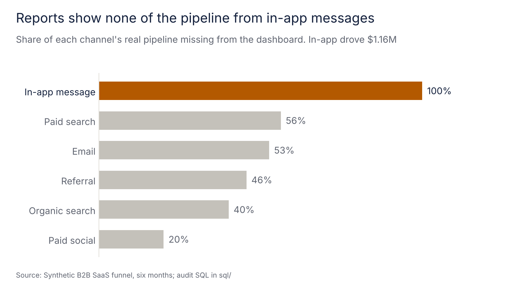
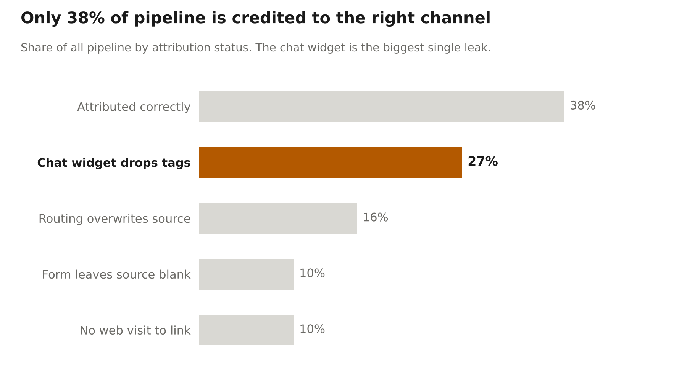

# Funnel and Attribution Audit: Where Is the Marketing Data Lying to Us?

A SQL audit of a B2B SaaS marketing funnel (six months of web sessions, leads, MQLs, opportunities and closed deals). It reconciles what the marketing dashboard reports against what actually happened, traces every gap to a root cause, and ranks the fixes by pipeline at stake.

Built in **DuckDB SQL**, with Python to generate the data and draw the charts.

## The question

Leadership decides where to spend the marketing budget based on pipeline by channel. **Can we trust those numbers, and if not, how wrong are they and why?**

The dataset is synthetic but realistic. It is generated with five common tracking failures built in: a chat widget that drops campaign tags, lead routing that overwrites the original source, a form with no source field, duplicate leads, and bot clicks. The audit has to find each one from the data alone. A hidden ground-truth file is used only at the end, to check that the audit got it right.

## What the audit found

**Only 38% of the $6.30M pipeline is credited to the right channel.**

| Finding | Impact |
|---|---|
| **In-app messages are invisible in reporting** | They drove $1.16M in pipeline (second-highest value per session of any channel) and the dashboard credits them with $0 |
| **"Direct" is inflated nearly 5x** | Dashboard shows $2.32M; the real figure is $0.48M. The chat widget files its leads under "Direct" |
| **Every channel is under-credited** | Paid search is missing 56% of its pipeline, email 53%, referral 46%, organic search 40% |
| **6% of lead records are duplicates** | The same person submitting twice inflates leads and MQLs (1,499 reported MQLs against 1,408 real) |
| **26% of paid social sessions are bots** | Real visitor-to-lead rate is 0.48%, not the 0.36% the dashboard shows. Paid social is still the weakest channel either way |

### Root causes, ranked by pipeline at stake

| Root cause | How the audit spots it | Pipeline affected | Fix |
|---|---|---|---|
| Chat widget drops campaign tags | Chat leads recorded as "Direct", but their web session came from a campaign | $1.70M (27%) | Pass campaign tags into the chat widget's lead record |
| Lead routing overwrites the source | Routed leads all show "Sales Inbound", which is not an acquisition channel | $1.02M (16%) | Write the routing result to its own field; never overwrite the original source |
| A form leaves the source blank | Every lead from the in-app request form has an empty source | $0.61M (10%) | Add the hidden source field to that form |
| No web visit to link | 10% of leads have no visitor id (cookies blocked) | $0.61M (10%) | Capture first touch on the form itself, server-side; report these honestly as "Unresolved" until then |
| Duplicate leads | Same email within 7 days | 196 lead records | Deduplicate at lead creation |
| Bot clicks | Sessions under 5 seconds with one page | 16,804 sessions | Filter bot traffic in analytics and in paid social reporting |

## Charts





## What the corrected funnel says about budget

Pipeline per 1,000 real (non-bot) sessions, after reattribution and deduplication:

| Channel | Sessions (excluding bots) | Leads | MQLs | Opportunities | Pipeline | Pipeline per 1,000 sessions |
|---|---|---|---|---|---|---|
| Referral | 12,141 | 219 | 127 | 47 | $0.80M | $66,016 |
| In-app message | 17,872 | 479 | 280 | 100 | $1.16M | $64,788 |
| Email | 29,821 | 435 | 223 | 69 | $1.01M | $33,721 |
| Paid search | 53,544 | 636 | 290 | 96 | $1.50M | $28,026 |
| Direct | 35,648 | 327 | 137 | 34 | $0.48M | $13,406 |
| Organic search | 72,477 | 521 | 184 | 52 | $0.81M | $11,112 |
| Paid social | 47,971 | 232 | 65 | 11 | $0.11M | $2,337 |

Using the dashboard as it stands, a team would likely cut in-app messaging (apparently $0 pipeline) and credit "Direct" for results it did not drive. The corrected view says the opposite: in-app messaging is one of the two most productive channels per session.

## How the audit works

All logic is SQL in [`sql/`](sql), run in order:

1. [`01_load.sql`](sql/01_load.sql): load the web analytics and CRM exports as they are
2. [`02_reported_view.sql`](sql/02_reported_view.sql): reproduce the dashboard (pipeline by CRM lead source)
3. [`03_data_quality.sql`](sql/03_data_quality.sql): find suspicious sources, duplicates (`ROW_NUMBER` and `FIRST_VALUE` by email), likely bots, and how many leads can be linked to a web session
4. [`04_reconstruct.sql`](sql/04_reconstruct.sql): rebuild each lead's real channel from its first web session (`QUALIFY ROW_NUMBER() OVER (PARTITION BY visitor_id ...)`), drop duplicates, and label each lead's attribution status. Leads that cannot be linked are marked "Unresolved" rather than guessed
5. [`05_reconciliation.sql`](sql/05_reconciliation.sql): reported vs real MQLs and pipeline by channel, and pipeline by root cause
6. [`06_corrected_funnel.sql`](sql/06_corrected_funnel.sql): the funnel by channel with bots removed and real channels applied

**Validation against ground truth** ([`results/validation.csv`](results/validation.csv)):

| Check | Result |
|---|---|
| Leads with a resolved channel | 93.2% |
| Accuracy of resolved channels | 100% |
| Bot sessions caught | 100% |
| Real sessions wrongly flagged as bots | 0.03% |

In real data, the reconstruction would not be perfect. The equivalent check is to hand-verify a random sample of leads against their session history before publishing corrected numbers.

## Repository structure

```
scripts/
  generate_data.py     synthetic sessions, leads and funnel outcomes with known defects
  run_audit.py         run the SQL, export results, validate against ground truth
  make_charts.py       README charts
sql/                   the audit, in run order
results/               every audit output as CSV
charts/                README charts
```

## How to run it

```bash
pip install duckdb pandas numpy matplotlib
python scripts/generate_data.py
python scripts/run_audit.py
python scripts/make_charts.py
```

## Limitations

- **Synthetic data.** The defects are realistic but planted, so their sizes are illustrative. The method is what transfers: reproduce the report, reconcile against raw events, label every gap, rank fixes by impact
- **First-touch attribution only.** Each lead is credited to the session that created it. A multi-touch view would spread credit across earlier visits
- **Bot rule is simple.** Real bot traffic is harder to separate; a production version would add user-agent and click-pattern checks

## Licence

MIT. All data is synthetic and generated by the code.
